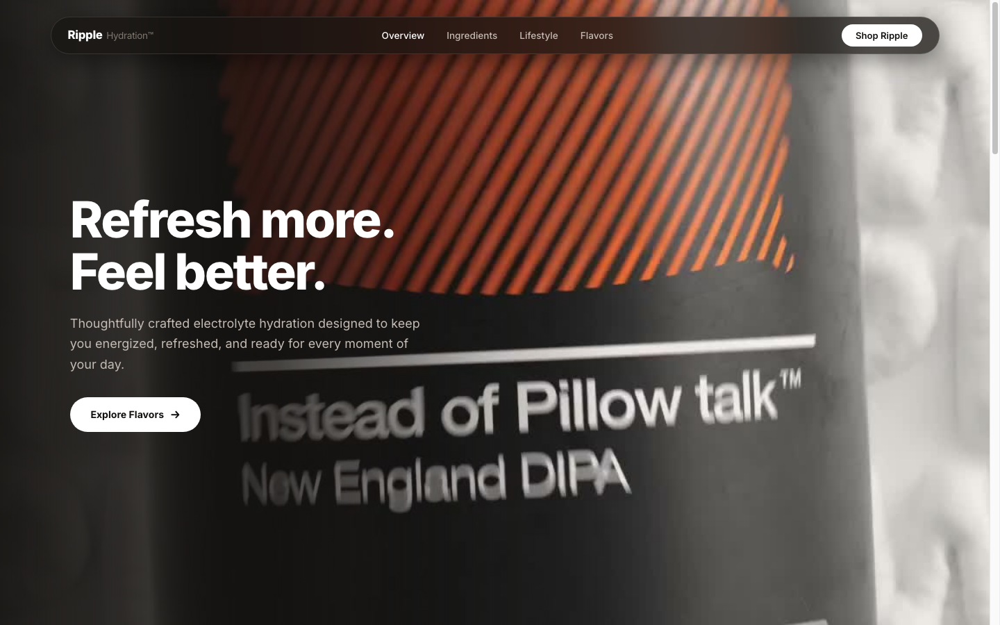

# Ripple Hydration™ — Electrolyte Drink Website
> **Cinematic Scroll-Driven Experience**  
> Built with `scroll-craft` principles, Vite, and Lenis Smooth Scroll.



## 📌 Overview
Website interaktif bertema minuman elektrolit modern **Ripple Hydration™** (*Refresh more. Feel better.*). Menggunakan 500 frame sequence kanvas 3D yang berputar seiring scroll, dipadukan dengan tipografi editorial bersih font **Inter** dan navigasi mengalir bebas *clutter*.

---

## 🛠️ Fitur Utama
* **500-Frame Retina Canvas Scrubber:** Full-bleed `cover` background yang di-scrubbing halus menggunakan LERP interpolation 60 FPS.
* **Natural Vertical Scroll Stream:** Teks heading dan deskripsi mengalir secara alami dari bawah melintasi layar hingga ke balik navbar kaca frosted.
* **Pure Inter Typography:** Desain bersih, mewah, dan modern tanpa elemen AI slop atau kartu-kartu yang menutupi visual.
* **Lenis Smooth Scroll:** Kontrol scroll ultra-halus dengan penyesuaian menu aktif secara otomatis.

---

## 🚀 Cara Menjalankan

```bash
# 1. Masuk ke direktori
cd "ripple - Electrolyte Drink Website"

# 2. Jalankan server lokal
npm run dev
```

Buka URL lokal yang muncul (default: `http://localhost:5174`) di browser Anda.
